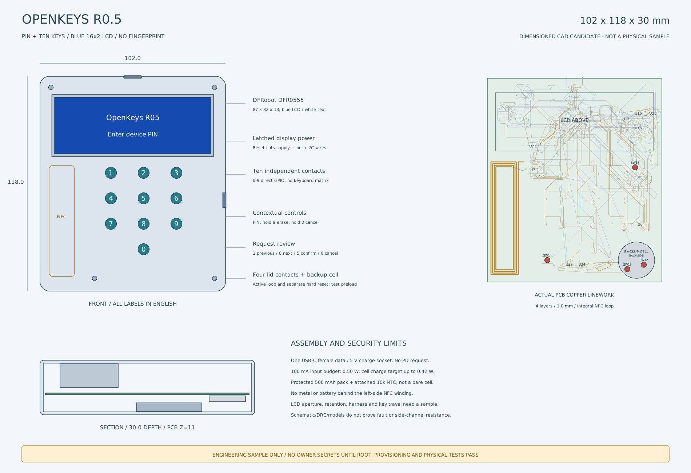

# OpenKeys

开源 USB / NFC 认证器，面向个人制作的 **3 把密钥**。当前电路为 **R0.5：本地六位 PIN、十个数字实体键、DFR0555 双行 LCD**；自研运行代码采用 Rust。

> **工程候选，生产放行 BLOCKED。** 已有已布线电路板、制造文件、板级诊断和经过测试的安全模块。完整生产 Root、认证协议与管理通道的实机集成尚未完成，不能将当前诊断固件用于真实账户。

[当前进度](docs/DEVELOPMENT_STATUS.md) · [文档导航](docs/README.md) · [硬件与图纸](hardware/r05/README.md) · [从原材料开始制作](manufacturing/BUILD_R05_ZH.md) · [安全复查](docs/SECURITY_REVIEW_R05.md)

最新要求增加 CanoKey 功能与硬件保护的 SM2、ML-DSA-65、ML-KEM-768，见[双安全芯片选型与授权评估](docs/DUAL_SE_REVIEW_R05.md)。现有 PCB 仍为单 SE，SE050E2 不支持 RSA；新算法、电源修正和第二颗芯片尚未落板，当前制造包不覆盖新增目标。



*工程图，非实物照片。板体 96 × 112 mm；外壳候选 102 × 118 × 30 mm，待试装。*

## 当前固定需求

| 项目 | 设计目标与现状 |
|---|---|
| 本地身份验证 | 首次开机在钥匙设置六位数字 PIN，十个独立 GPIO 键；没有指纹。改硬件 PIN 清空全部用户数据，第 11 次完整错误猜测触发清空；完整销毁服务尚待集成 |
| 会话授权 | 硬件 PIN 与各协议 PIN 分别缓存，同一已配对认证会话中 30 秒无有效操作锁定；连接 / 保活不续期，断连 / NFC 离场立即锁定，敏感操作仍需实体确认 |
| 显示 | 英文 16 × 2 LCD，DFRobot DFR0555 蓝底白字；现货及版本说明见硬件页 |
| 认证 | FIDO2 / WebAuthn / Passkey、U2F、hmac-secret、凭据管理；OpenPGP / PIV / SSH 为新增待集成目标 |
| OTP 与记录 | TOTP / HOTP 种子不可导出，六位码仅钥匙 LCD 显示；加密 notes / recovery codes；均受本地 PIN 约束 |
| 接口 / 电源 | 唯一外部 USB-C 母口，USB 2.0 数据兼 5 V 充电，另有 NFC；保护型 500 mAh 电池与真实 NTC |
| 管理器 | GPUI 英文桌面原型；macOS / Windows / Linux USB，iOS NFC / USB-C、iPadOS USB-C、Android NFC / USB-C 为交付目标，真实设备后端和移动安装包尚未完成 |

Apple 20 W 充电器使用 **5 V**，不申请 9 V PD。设计输入预算 **0.50 W**，电池侧充电目标上限约 **0.42 W**，实际受负载、温度和限流影响；诊断镜像关闭充电。

## 从这里开始

| 目的 | 入口 |
|---|---|
| 查看电路、PCB、BOM、结构和制造包 | [R0.5 硬件](hardware/r05/README.md) |
| 了解哪些完成、哪些不能交付 | [状态](docs/DEVELOPMENT_STATUS.md)、[安全复查](docs/SECURITY_REVIEW_R05.md) |
| 构建与检查 | [开发起步](docs/GETTING_STARTED.md)、[R05 目标](firmware/r05/README.md)、[GPUI 管理器](apps/manager-gpui/README.md)、[开发包](docs/NATIVE_BUILDS_R05.md) |
| 核查 PIN 缓存与 NFC 边界 | [会话规则](docs/PIN_SESSIONS_R05.md)、[架构](docs/ARCHITECTURE.md) |
| 从原材料、订板到代焊和测试 | [制作手册](manufacturing/BUILD_R05_ZH.md)、[境内渠道](manufacturing/MAINLAND_COMPONENT_CHANNELS.md) |
| 委托个人 / 小批量工厂、实验室 | [机构筛选](manufacturing/MAINLAND_SUPPLIERS_AND_LABS.md)、[资格确认](manufacturing/REQUEST_FOR_CONFIRMATION.md) |
| 比较已拉取的开源实现 | [PicoKeys / OpenSK / CanoKey / SoloKeys 参考](docs/UPSTREAM_REVIEW_R05.md) |

## 检查的含义

R05 当前有 10 页原理图、151 个 BOM 位置、四层已布线 PCB；ERC / DRC 零错误、零警告、零未连接，705 项独立板网核对通过。[CAD 清单](hardware/r05/review/cad-manifest.json)绑定导出文件。它们验证设计文件的规则和连通性，不能证明实物抗侧信道、故障注入、EMC、RF、充电或抗拆安全。

新代码的[本地检查记录](docs/r05-validation.json)与 CI 以对应提交为准；[R04 的历史 CI](docs/ci-evidence-r04.json)不能作为 R05 的通过证明。[生产缺口](docs/DEVELOPMENT_STATUS.md)逐项列出，完整 Root 和硬件 PIN 的 SE 原生强制仍是关键未关闭项。

```text
hardware/r05/      当前电路、PCB、BOM、机械和制造导出
firmware/r05/      与 R05 已保存板绑定的 ARM 电气诊断
firmware/board/    LCD、十键、PIN 输入、OTP 等候选驱动
crates/           授权、协议适配、SE、加密通信和存储模块
apps/manager-gpui/ GPUI 管理器原型；设备后端尚未接通
manufacturing/    制作、渠道、委托和验收资料
docs/             状态、安全边界、会话和参考复核
vendor/           固定第三方来源、许可和可核查补丁
```

自研源码采用 [MIT](LICENSE)，硬件采用 [CERN-OHL-S-2.0](hardware/LICENSE-CERN-OHL-S-2.0.txt)；第三方代码保留各自许可。历史 R04 指纹 / 四键资料从[硬件导航](hardware/README.md)进入，不能与 R05 混用。
