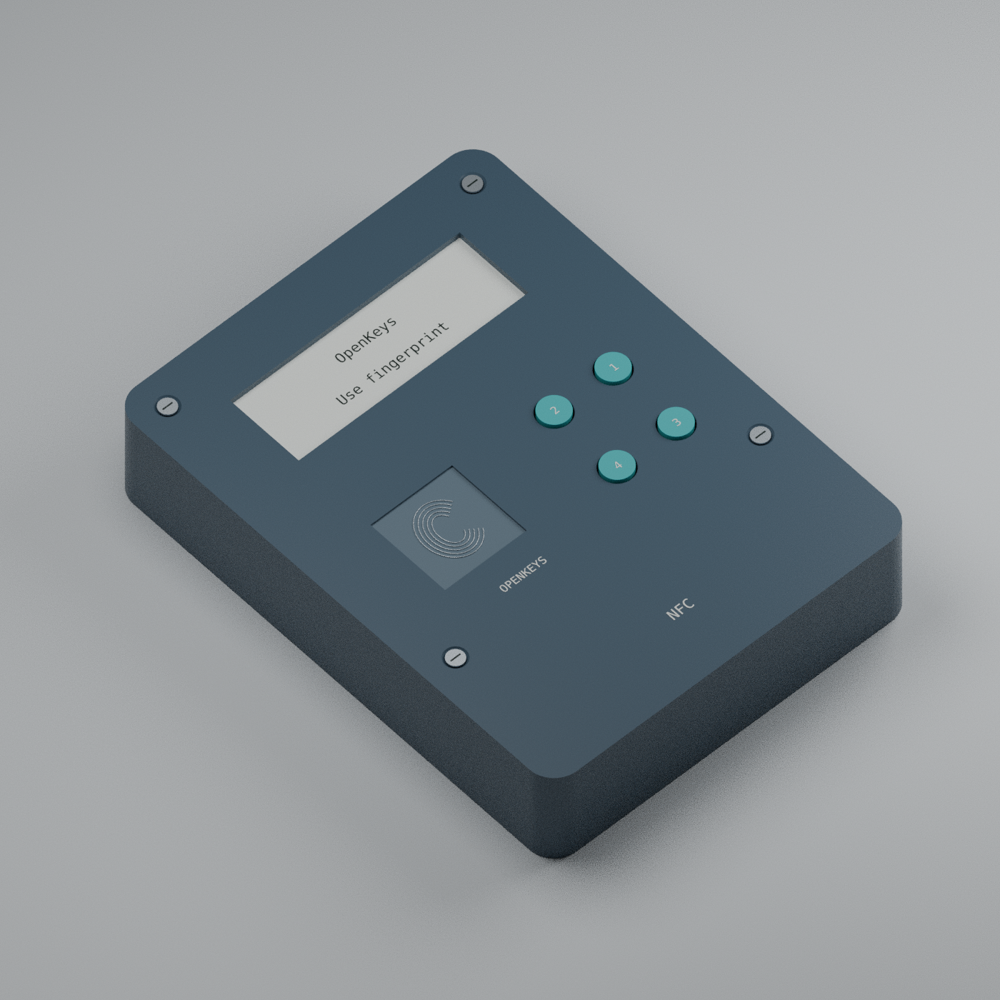

# OpenKeys R0.3

开源认证器研发工程：**设备指纹必需、PIN 仅作附加验证、双行白背光 LCD、四个场景按键、单个 USB-C 母口兼数据/充电、NFC**。英文产品界面。已取消动态验证码和 USB-A。

**当前是可审查的工程设计和软件部分实现，尚未达到可制造、可存放真实秘密的成品标准。** 未布线 PCB、缺少设备驱动的策略库、保持锁定的桌面管理器均不冒充已完成产品。尚无侧信道/故障注入/整机认证通过报告。



| 交付内容 | 入口与实际状态 |
|---|---|
| 新版电路 | [8 页 PDF](hardware/r03/exports/OpenKeys-schematic.pdf)、[KiCad 源文件](hardware/r03/kicad/OpenKeys.kicad_sch)、[BOM](hardware/r03/BOM.csv)、[引脚表](hardware/r03/pinout.csv) |
| 实物结构设计 | [尺寸 PDF](hardware/r03/exports/OpenKeys-dimensions.pdf)、[SVG](hardware/r03/exports/OpenKeys-dimensions.svg)、[OpenSCAD](hardware/r03/mechanical/OpenKeys.scad)、[STL](hardware/r03/exports)、[Blender 源文件](hardware/r03/mechanical/OpenKeys-assembly.blend)；尺寸 74 × 98 × 20 mm，仍需样件配合检查 |
| PCB | [四层放置研究](hardware/r03/kicad/OpenKeys-floorplan.kicad_pcb)，**没有电气走线或完整元件放置，不是制造板** |
| 固件部分 | [no_std Rust 授权/指纹/PIN/LCD 核心](crates/device-policy/src/lib.rs)、[目标与缺口](firmware/README.md)；可作 Cortex-M33 编译检查，尚无可烧录 FIDO 固件 |
| 桌面软件 | [AuthDesk](apps/manager)，Rust 原生 macOS/Linux/Windows GUI；设备认证通道未完成，故拒绝真实解锁/写入 |
| 移动端 | [Android/iOS NFC 可行性及前置条件](apps/mobile/README.md)；尚无可用 APK/IPA，不把手机指纹算作设备指纹 |
| 安全复查 | [R0.3 发现、修复与未解决风险](docs/SECURITY_REVIEW_R03.md)、[发布阻断检查](manufacturing/readiness-report.json) |

授权固定顺序为 **设备指纹 → 必要时设备 PIN → 完整请求显示与实体确认 → 单次操作**。导入、删除、恢复码读取、指纹管理、PIN 修改、配对、升级和擦除均要求附加 PIN。不存在 PIN 单独解锁路径；指纹故障或协议标签耗尽不会回退到 PIN。

PIN 使用 12 次四符号序列：短按 1–4 输入，长按 4 删除一位、长按 2 取消；菜单中四键分别为 Previous / Next / Confirm / Cancel。固定长度不代表用户选择具备 24 位真实熵，必须有受保护的持久重试限制。

充电设计为 **5V、100mA 输入限流，约 0.5W 输入功率预算**；电池侧目标 100mA、4.2V 上限（约 0.42W，实际随电量和整机负载下降）。兼容 Apple 20W USB-C 适配器的 5V 档，使用合规 USB-C 线，不请求 9V，也不消耗 20W。充电需开启主电源运行后台充电服务；服务不要求解锁秘密。见[电源与电池说明](hardware/r03/README.md)。

目标仍包括 FIDO2/WebAuthn/Passkey、U2F、hmac-secret、凭据管理、加密 notes/recovery codes。功能是否可用须看实物固件证据，不能由列表推断已实现。备份域低频时钟只用于防拆留痕与超时设计，不提供动态验证码。

```sh
cargo test --workspace --locked
cargo clippy --workspace --all-targets --locked -- -D warnings
cargo fmt --all -- --check
cargo check -p device-policy --target thumbv8m.main-none-eabihf --locked
cargo run -p authdesk --release --locked
```

[构建与验证状态](docs/VALIDATION.md)记录本地检查和 GitHub Actions；CI 将编译器警告、Clippy 警告和依赖审计警告视为失败。电路 ERC 的两个 RF 封装警告公开保留，并阻止制造发布，未被隐藏成“硬件全通过”。

R0.3 活跃硬件位于 `hardware/r03/`；原 `hardware/kicad/`、`hardware/exports/` 及对应旧评审资料是保留的 R0.2 历史设计，不能混用。制造任务书与发布脚本以 R0.3 为准。

自己的软件采用 [MIT](LICENSE)，硬件源文件采用 [CERN-OHL-S-2.0](hardware/LICENSE-CERN-OHL-S-2.0.txt)。第三方符号与上游参考保留原授权；[参考版本](references.lock.tsv)包括 Solo 2、OpenSK、Trussed/Nitrokey 与 Wasefire。未把上游认证或安全评价转移给本设计。
