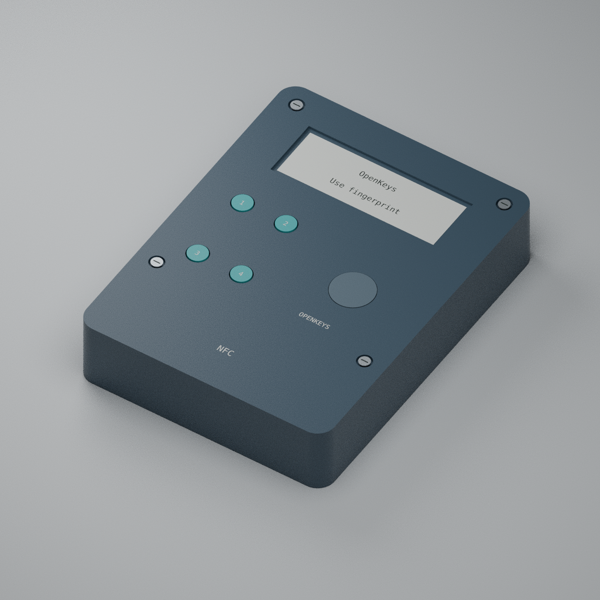

# OpenKeys

开源 USB / NFC 指纹认证器，面向个人自制的 3 把安全密钥。当前硬件版本为 **R0.4**，自研运行代码使用 Rust。

> **工程候选 · 尚未生产放行**
> 已有电路、PCB、结构设计和通过测试的软件模块；完整认证固件、真实管理通道及实物安全验证仍未完成。当前开发包和诊断镜像不能用于真实账户。

[文档导航](docs/README.md) · [当前进度](docs/DEVELOPMENT_STATUS.md) · [开始开发](docs/GETTING_STARTED.md) · [术语速查](docs/GLOSSARY.md) · [制造与验收](manufacturing/README.md) · [安全复核](docs/ADVERSARIAL_REVIEW_R04.md)



*CAD 渲染：外壳 74 × 98 × 20 mm，需工程样板试装。*

## 项目目标

| 项目 | 固定范围 |
|---|---|
| 身份验证 | 设备指纹必需；四键 PIN 仅作附加验证，不能单独解锁 |
| 设备交互 | 白色背光 16 × 2 英文字符 LCD，四个场景按键 |
| 接口与供电 | 唯一 USB-C 母口，USB 2.0 数据 / 5 V 充电；NFC；500 mAh 保护电池及真实 NTC |
| 认证与存储 | FIDO2 / WebAuthn / Passkey、U2F、hmac-secret、凭据管理、加密 notes / recovery codes |
| 管理软件 | macOS / Linux / Windows；Android / iOS NFC 管理作为独立交付目标 |

授权顺序：**设备指纹 → 必要时设备 PIN → 完整请求与实体确认 → 一次操作**。私密标题和列表也需要设备授权。已取消动态验证码、图形屏幕及 USB-A。

Apple 20 W 充电器使用 **5 V** 档；设计输入预算约 **0.50 W**，电池侧充电目标上限约 **0.42 W**，实际受系统负载与电量影响。[供电和器件说明](hardware/r04/README.md)

## 从这里开始

| 我想做什么 | 阅读入口 |
|---|---|
| 了解哪些已经完成 | [当前状态与交付缺口](docs/DEVELOPMENT_STATUS.md) |
| 查看原理图、PCB 和外壳 | [R0.4 硬件文件](hardware/r04/README.md) |
| 构建代码或运行开发界面 | [开发起步](docs/GETTING_STARTED.md)、[开发包下载](docs/NATIVE_BUILDS.md) |
| 了解代码和安全边界 | [架构](docs/ARCHITECTURE.md)、[固件模块](firmware/README.md) |
| 找个人、小批量服务商 | [大陆厂商和实验室筛选](manufacturing/MAINLAND_SUPPLIERS_AND_LABS.md) |
| 从零准备材料、订板和代焊 | [完整制作说明书](manufacturing/BUILD_MANUAL_ZH.md)、[打印版 PDF](manufacturing/OpenKeys-R04-build-manual-zh.pdf)、[工厂确认单](manufacturing/ORDER_SHEET_R04.md) |
| 验收样板和安全测试 | [硬件验收步骤](manufacturing/HARDWARE_ACCEPTANCE.md)、[测试计划](docs/SECURITY_TEST_PLAN.md) |
| 修改或参与项目 | [贡献指南](CONTRIBUTING.md)、[安全问题报告](SECURITY.md) |

## 当前验证

- 硬件：10 页原理图、130 个 BOM 位置、四层 PCB；ERC / DRC 零错误、零警告、零未连接；624 项独立板网检查，89 个 CAD 文件摘要。
- 软件：macOS、Linux、Windows **各 191 项测试通过**，严格 Clippy、ARM 编译及依赖审计通过；[该源码的 CI](https://github.com/Jay-Void-BA/OpenKeys/actions/runs/42723819737) 完整日志和注释均为 0 条 warning。
- 边界：上述是源码、连通性和模型证据。实物指纹、防拆、抗干扰、侧信道及故障注入尚未通过；生产预检仍为 **BLOCKED**。

[证据与精确提交](docs/ci-evidence-r04.json) · [未关闭安全风险](docs/ADVERSARIAL_REVIEW_R04.md) · [交付预检](manufacturing/readiness-report.json)

## 仓库结构

```text
hardware/r04/   当前电路、PCB、BOM、结构与制造导出
firmware/      板级驱动、目标适配和电气诊断镜像
crates/        授权、认证、密码通信与加密存储模块
apps/          桌面管理器，以及移动端实现前提
manufacturing/ 委托范围、供应商筛选和验收资料
docs/          状态、架构、开发指南、安全审查与验证记录
scripts/       来源、摘要、布局及交付检查
vendor/        固定版本的第三方源码及明确补丁
```

## 许可与版本

自研运行源码采用 [MIT](LICENSE)，硬件采用 [CERN-OHL-S-2.0](hardware/LICENSE-CERN-OHL-S-2.0.txt)。[OpenSK 子集及补丁](vendor/opensk/README.md) 保留 Apache-2.0；其他第三方材料保留各自许可。

[参考版本](references.lock.tsv) 包含 Solo2、OpenSK / Wasefire、Nitrokey / Trussed 等。旧版资料从[硬件历史入口](hardware/README.md)和[文档索引](docs/README.md)查阅；R0.2 / R0.3 文件不能与 R0.4 混用。
