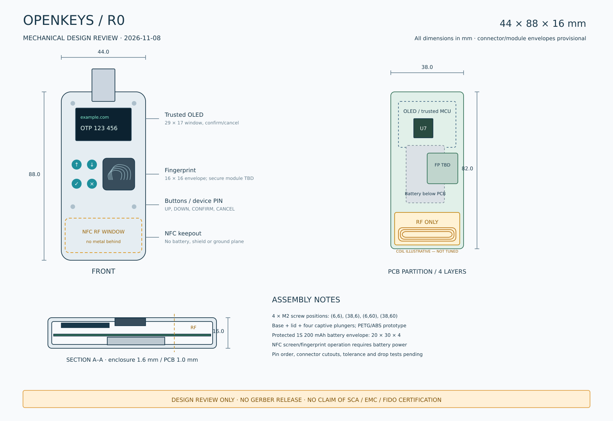

# OpenKeys

Rust 开源认证器研发工程：USB-A + USB-C + NFC、设备指纹与 PIN、可信屏幕、FIDO2/U2F、屏幕 TOTP，以及加密 notes / recovery codes 的目标设计。

**当前交付的是可编辑电路与结构设计、Rust 授权/导入库和桌面管理器开发版。尚无完整设备固件、可投产 PCB 或已验证安全的成品。请勿存入真实账户凭据、OTP 种子或恢复码。**



[查看外观模型](hardware/exports/OpenKeys-assembly.png) · [7 页电路图 PDF](hardware/exports/OpenKeys-schematic.pdf) · [可编辑 KiCad 工程](hardware/kicad/OpenKeys.kicad_pro) · [OpenSCAD 外壳](hardware/mechanical/OpenKeys.scad)

| 内容 | 实际状态 |
|---|---|
| 电路设计 | 7 页 KiCad 9 原理图；117 个 BOM 位号；网表与检查记录随附 |
| 电气规则检查 | 0 个错误、8 个待选封装警告；这些警告保留为发布阻断项 |
| 外壳 | 尺寸图、OpenSCAD、Blender 场景、底壳/上盖/按键 STL；未打印装配验证 |
| PCB | 四层板尺寸与安全/RF 分区草案，含规则禁布区；未布线，无 Gerber |
| Rust 代码 | no_std 授权模型、TOTP/notes 导入库、原生 AuthDesk GUI；17 项测试已通过 |
| macOS / Windows / Linux | Linux GUI 已运行；Windows/macOS 交叉编译检查已通过；尚无正式安装包 |
| 设备管理 | USB 公开信息发现可用；真实解锁、加密通道和写入适配未实现，默认拒绝 |
| 安全和兼容性 | 无整机 FIDO、侧信道、故障注入或 EMC 合格报告；iOS/NFC 互操作待实测 |

## 设计边界

- STM32U585RIT6 + SE050E：目标是私钥、hmac-secret 根秘密和 OTP HMAC 在安全元件内运算；外部 Flash 仅存认证加密数据。上述设备端策略尚未实现。
- USB 2.0 Full Speed，双物理接口通过数据选择器和防倒灌电源 MUX 连接；USB-C 仅作受电端，不使用 USB 3.x 或 PD。
- 设备显示站点标识、操作与确认/取消。私密列表、OTP 和 notes 仅在设备指纹或**设备 PIN 备用**验证后显示。电脑指纹不替代设备验证。
- 完整 NFC 屏幕/指纹流程依赖电池；不承诺 RF 采能可带动整机。
- 可信指纹模块的料号、协议和小批量可采购性尚未确定，这是安全与机械设计的发布阻断项。
- 自写运行代码采用 Rust，不包含自写 C/C++；CAD 工具脚本使用 Python/OpenSCAD。芯片内部 ROM/安全元件 applet 与操作系统库不属于本项目开放源码。

## 导航

- [硬件文件与打开方法](hardware/README.md)
- [必须先解决的制造与安全问题](hardware/RELEASE_GATES.md)
- [电路设计依据](hardware/DESIGN_REVIEW.md)、[BOM](hardware/BOM.csv)、[MCU 引脚表](hardware/pinout.csv)
- [大陆打样/代焊渠道与询价材料](hardware/MANUFACTURING.md)
- [安全边界和权限](docs/ARCHITECTURE.md)、[低/中/高三档与预算限制](docs/TIERS.md)
- [8 个开源参考方案比较](docs/OPEN_SOURCE_REVIEW.md)、[固定提交](references.lock.tsv)
- [导入格式](docs/IMPORT_FORMAT.md)、[软件验证记录](docs/VALIDATION.md)

## 构建

```sh
cargo test --workspace --locked
cargo clippy --workspace --all-targets --locked -- -D warnings
cargo run -p authdesk --locked
```

工具链见 `rust-toolchain.toml`。管理器保持锁定，直到真实设备后端实现验证；没有模拟解锁入口。三个系统的原生构建工作流为手动触发，未将工作流配置当作已完成平台验收。Linux GUI 需要系统图形库与文件选择 portal。

重取上游参考：`sh scripts/fetch-references.sh`。锁定 8 个上游提交并校验，不把庞大的第三方 Git 工作树重复塞入本仓库；参考代码不参与默认构建。源码快照仍适用各自许可证。

## 许可

软件沿用仓库原有 [MIT License](LICENSE)，Copyright © 2026 Jay-Void-BA。

`hardware/` 自作电路、结构与生成脚本采用 [CERN-OHL-S-2.0](hardware/LICENSE-CERN-OHL-S-2.0.txt)；第三方 KiCad 库和参考资料见 [硬件第三方声明](hardware/THIRD_PARTY.md)。上游许可证不被替换。第三方芯片数据手册通过链接引用，不重新分发。
