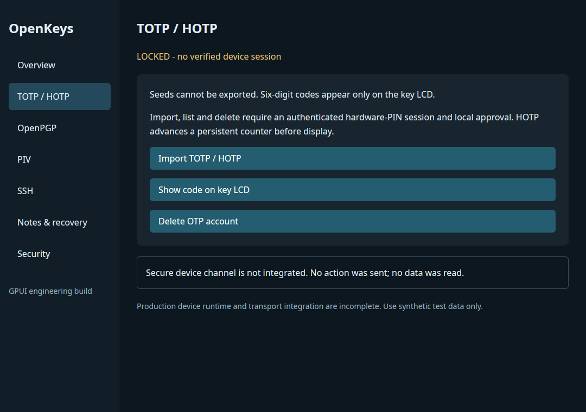
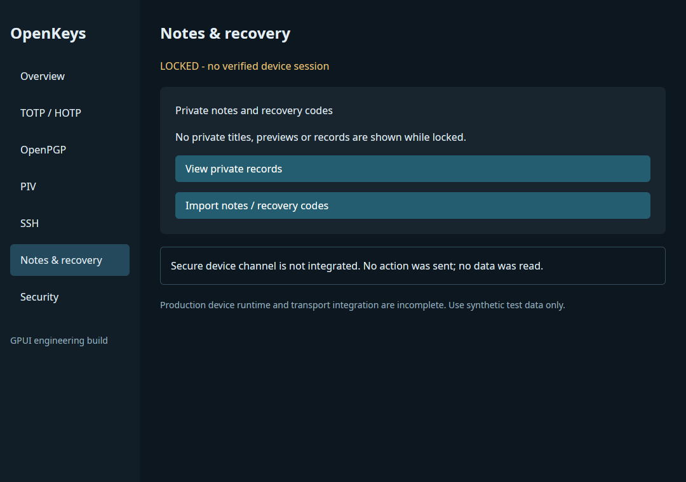

# OpenKeys GPUI manager

English GPUI desktop **prototype**, implemented in Rust. The real authenticated
device backend is not integrated: device buttons deliberately return
`SecureChannelUnavailable`. No secret can be imported, unlocked or displayed
through this placeholder. This is not a production manager.

```sh
cargo +1.99.1 run -p openkeys-manager --features gui --locked
```

Linux builds require the platform development libraries listed in the build
workflow. macOS and Windows use their native GPUI backends. Published GPUI CE
0.3.0 is pinned, with documented maintenance patches in
[gpui-support](../../vendor/gpui-support/README.md).

Sections cover TOTP/HOTP, OpenPGP, PIV, SSH, notes/recovery and security. OTP
seeds are import-only; six-digit codes can be requested only on the key LCD,
never returned to the manager. First boot sets the six-digit hardware PIN on
the key. Protocol PINs are independent, with the
[paired-session 30-second rules](../../docs/PIN_SESSIONS_R05.md).

Desktop USB, iOS NFC/USB-C, iPadOS USB-C and Android NFC/USB-C are separate
integration targets, not presently working app bundles. See
[mobile constraints](../mobile/README.md). GPUI mobile source availability
does not establish device transport, signing or platform compatibility.

## Observed Linux prototype

Local Rust build launched on X11/Xvfb. Navigation and the rejected connect,
OTP-display and private-record actions were checked without a device. These
screenshots show the locked prototype, not successful hardware authorization.
No physical USB/NFC, code generation on hardware or authenticated import was tested.




