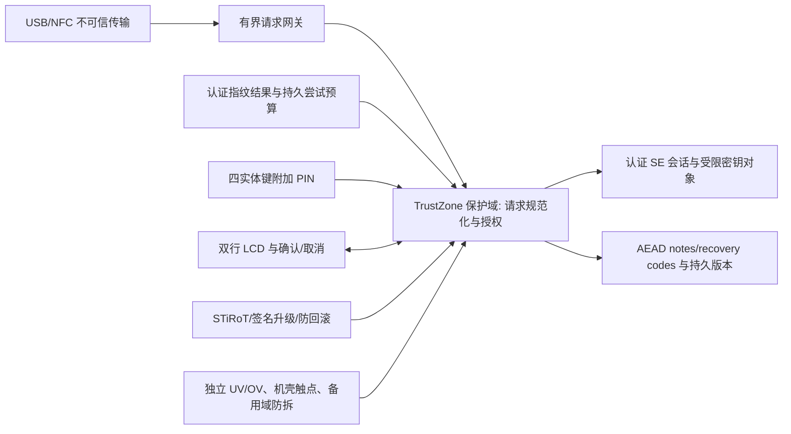

# R0.3 安全边界与实现状态

这是设计约束，实际已实现范围见 README 和 SECURITY_REVIEW_R03。目标主控为 STM32H573RIT6；旧 U585/OLED/OTP/双 USB 方案已被 R0.3 取代。

软件、MCU 隔离和 SE 策略共同构成授权边界。电路中 SE_EN 的 AND 门只是在复位或供电异常时禁止使能；它不能判断指纹是否真实，也不能替代受保护固件。必须由不可变启动根验证固件，再用硬件归属设置限制 FP、SE、LCD、GPIO、DMA、时钟和敏感内存。尚未实现或测定这些配置，当前不能声称已在硬件上完成强制指纹授权。

| 操作 | 固定条件 |
|---|---|
| 充电、USB 发现、公开能力查询 | 不含账户、标题、凭据或秘密；不授予访问权限 |
| 验证指纹所需的内部密码运算 | 受保护的验证过程本身；不是已解锁的用户操作 |
| 私密元数据、note、FIDO 注册/签名、hmac-secret | 新鲜设备指纹 + 设备请求确认；独立绑定操作、摘要与连接 |
| 恢复码读取、导入、删除、指纹管理、PIN 变更、配对、固件升级、擦除 | 指纹 + 设备四键 PIN + 本次明确确认 |

电脑/手机指纹、NFC 进场、USB 枚举、主机 Boolean 或 PIN 输入均不能代替设备指纹。指纹失效和 16 位协议标签耗尽后也不允许 PIN 单独访问。首次空白初始化是无用户秘密的物理配对流程；已经配置的设备不得因断电、备用域丢失或模块复位而重新开放初始化。

`Gate` 不提供选择授权方法的参数。只有 `biometric::Session` 能产生外部调用者不可构造的指纹凭据。附加 PIN 和 LCD 查看器需要该凭据；设备根据 Operation 决定 PIN 要求。阻塞验证、PIN、确认及消费共用原始 15 秒期限，每个阻塞步骤之后读取可信实时单调时钟。一次授权只消费一次；错误、取消、连接变化、休眠、复位和异常必须撤销。

这些是可测的策略库约束，不等于完整受保护运行时已部署。生产适配器必须真实验证配对密钥、持久计数和硬件状态，不能返回模拟成功。消费授权与实际 SE 操作之间不得返回不可信执行域。

## 指纹、PIN 与可信显示

FPC2534AM 的 GCM 验证、持久预扣、操作 tag、目标模板、完整请求和期限共同绑定验证。共享双向密钥意味着受保护 MCU 若能被滥用为加密 oracle，仍可能伪造传感器方向的帧；因此不能给 USB/NFC 暴露原始加解密或 SE APDU API。见 BIOMETRIC_PROTOCOL。

PIN 只通过安全 GPIO 取得的实体按键释放事件输入：固定 12 个 1–4 符号，长按 4 删除、长按 2 取消。长按不得同时形成短按。输入前持久预扣一次尝试，取消/断电不退款；SE 内常时比较和持久限次尚待实现。12 符号最大组合空间不代表人选 PIN 的真实熵。

LCD 只显示英文系统界面。FIDO2 站点身份使用完整 ASCII/Punycode RP ID，拒绝静默截断或 Unicode 替换。分页需逐页显示确认后才能批准；这不证明主机声称的站点可信，固件必须核对它与实际签名内容的关联。U2F 请求只有应用 ID 哈希，不能编造域名，应显示旧协议及可核对哈希。取消、过期、时钟异常和锁定须清除物理显示内容；驱动还要定时刷新和处理 LCD 复位。

## 密钥、存储与管理通道

FIDO 私钥及 hmac-secret 根秘密应在经验证的保护域运算，不导出到不可信 MCU/主机。认证的 SE 会话、对象权限、每设备生产密钥和抗回滚计数必须逐项验证。SE 证书不能给整机背书。NXP 内部 applet/ROM 是第三方信任边界，不是项目的可审查 Rust 代码。

外部 Flash 中的 notes、recovery codes、标题及版本须 AEAD 加密认证，并有唯一 nonce、持久版本、掉电原子提交和受控备份。AEAD 本身不防完整旧密文回滚。三把 FIDO 钥匙分别注册；恢复码另保留独立离线备份。当前没有设备持久 vault 实现。

管理器的导入解析仅接受 v2 JSON notes/recovery codes；OTP 和旧 URI 已移除。原始导入文件与被允许解密的内容本来会出现在主机内存，zeroize 只尽量擦除拥有的缓冲，不能保证 GPU/交换区/崩溃转储没有副本。受控主机仍能窃取用户明确释放到主机的明文。

设备身份和管理协议尚未实现，故管理器保持锁定。未来通道必须采用经审查的认证加密设计，限制长度、序号、方向、权限和连接上下文；不能把 VID/PID、序列号、UID 或无密钥摘要当作设备身份。不得把未经评审的自制握手当成既有安全协议。

## 供电、抗扰与物理攻击

单 USB-C 接口、独立 CC 下拉、输入eFuse过压切断/反向阻断和低电容 ESD；BQ25185 硬件固定 4.2V/100mA 输入档及 100mA 充电目标；受保护电池与实际 NTC。TPS3702 在 3.3V 越窗时独立复位，机壳触点经开漏缓冲独立复位；SE 使能受复位线门控。VBAT 独立 3.0V 与 LSE 为关机留痕提供设计基础，备用丢失必须锁定而非自动变成空白设备。

独立监测存在传播延迟及 RC/电源时序窗口，无法据此覆盖快 VCAP 降压、EM/激光、芯片开封或传感器伪造。触点可被探针短接，尚无经验证主动网格。滤波、屏蔽、Rust 和随机延迟均不是无侧信道泄漏的证明。安全发布需要精确版本、威胁模型、时序量测、功耗/EM/时序分析与故障注入证据。

主参考：[STiRoT](https://wiki.st.com/stm32mcu/wiki/Security%3ASTiRoT_for_STM32H5)、[H573 数据手册](https://www.st.com/resource/en/datasheet/stm32h573ri.pdf)、[SE050](https://www.nxp.com/docs/en/data-sheet/SE050-DATASHEET.pdf)、[SE APDU](https://www.nxp.com/docs/en/application-note/AN12413.pdf)、[U2F 消息](https://fidoalliance.org/specs/fido-u2f-v1.2-ps-20170411/fido-u2f-raw-message-formats-v1.2-ps-20170411.html)。
