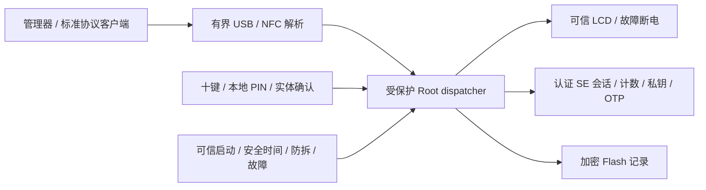

# R0.5 架构与信任边界

[当前进度](DEVELOPMENT_STATUS.md) · [PIN 会话规则](PIN_SESSIONS_R05.md) · [安全复查](SECURITY_REVIEW_R05.md)

正式范围：六位设备 PIN、十个独立数字键、DFR0555 16×2 LCD；没有指纹。硬件与协议 PIN 分别缓存，规则见会话文档。当前缺少完整生产 Root，下面是实现约束与已有模块边界，不能视为整机已安全集成。

## 授权与执行

首次配置要求真实工厂空白生命周期、六位本地 PIN 输入两遍、每设备随机 pepper / salt / 配对密钥、最后写有效标记。缺失、损坏或半写的对象不能被当成空白。配置接口目前只有策略与契约，真实 commissioning 服务未实现。

完成六位猜测后先持久预扣，再用 SE 内 HKDF 和常数时间比较验证；取消半次输入不扣预算。第十一次错误或改 PIN 先持久锁存 ERASE_PENDING；所有入口必须拒绝直到完整销毁与受控重新初始化。现有后端实现锁存，尚未实现全部命名空间的销毁。

[session Gate](../crates/device-policy/src/session.rs)把硬件 PIN、协议角色、配对对端、认证通道及物理连接场次绑定；30 秒空闲、保活不续期、断连撤权。完整请求每次在设备审阅，协议 PIN 权限在确认前后与执行前复查。旧 R04 生物识别 Gate 和四键 PIN 只保留历史测试，不能注册成 R05 备用解锁路径。

执行凭据不可由主机构造、克隆或序列化。每个 SE / 存储 / 输出服务在阻塞调用前后检查同一请求、代际、可信时间和故障状态；成功后消耗执行权限，返回不含秘密的完成凭据用于续会话。长事务有固定预算，不能借保活扩权。

## 必须保护的硬件

生产 Root 应独占 SE / LCD / 十键 GPIO、可信时钟、RTC / 备份域、DMA、故障与防拆中断、密钥内存、USB / NFC 授权 dispatcher。SE_EN 的 AND 门只在复位 / 故障时禁止使能，不判断 PIN。现有 MCU 比较和授权仍假设 Root 完整；若要求抵抗已被攻陷的 Root，必须实现并验证 SE 原生 PIN / 认证会话与私钥 ACL，不能把 GPIO 门称为独立硬件 PIN 证明。

LCD 无外部复位脚；异步清除锁存、切电、隔离 I2C、泄放、冷启动避免复位后恢复旧画面。真实最坏温度 / 电容 / 背供电 / 注入情况下的残影和响应必须测量。双行显示完整身份要分页，写屏成功和完整审阅后才能确认。

## OTP、OpenPGP、PIV 与 SSH

OTP 候选只允许 SE 内 HMAC 和设备 LCD 六位显示；无种子读取、无验证码响应 / USB 键盘。HOTP 先持久消耗旧计数再显示，丢应答不返还。TOTP 依赖受保护 RTC、可信设置时间与回退拒绝；当前 RTC 服务和种子导入尚未集成。

OpenPGP / PIV 应用尚待集成。SSH 可走 FIDO 安全密钥、PIV / PKCS#11 或 OpenPGP agent，它们的 PIN、签名策略和平台兼容性必须分别验证。上游研究不能代替实现，见[参考复核](UPSTREAM_REVIEW_R05.md)。

## 管理通道与主机边界

管理器需要真实设备身份与配对认证加密、版本 / transcript 绑定、单调消息序号、方向隔离及明确重放拒绝。底层存在 SCP03 不等于 USB / NFC 管理通道已经加密。公开发现不授权，NFC UID 不认证，标准 FIDO / CCID 不能继承管理缓存。

GPUI 界面已有，但真实后端目前明确返回不可用。导入 OTP 和 notes 必须采用有界解析、加密上传、设备确认与提交；OTP 种子不可再次导出。主机在导入时原本已看到秘密，zeroize 不能保证 OS、剪贴板、GPU、交换区没有副本；恶意主机能读取被用户明确释放到主机的 notes。

桌面使用 USB，iOS / iPadOS USB-C 应评估 CCID / CryptoTokenKit 及 entitlement，iOS / Android NFC 使用 ISO7816 / IsoDep；不能假设所有平台都有任意 USB HID 管理 API。实际手机应用、签名、权限和设备验证尚未完成。
