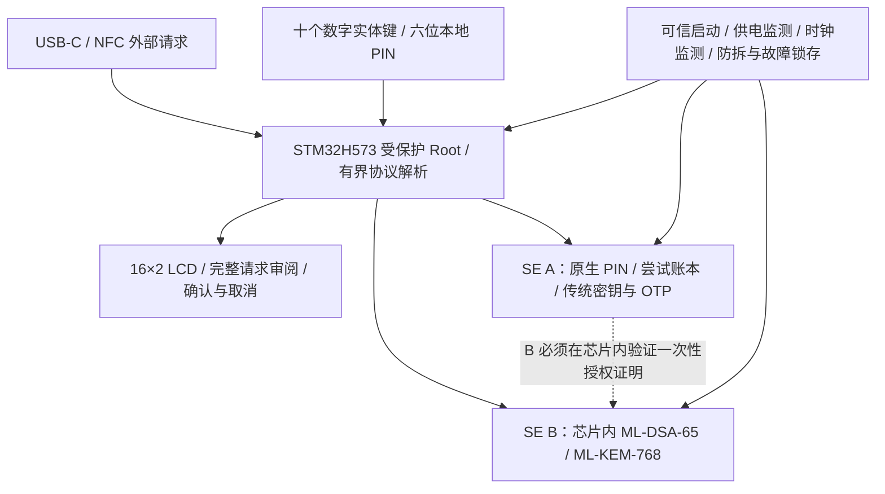

# 双安全芯片架构评估

[状态](DEVELOPMENT_STATUS.md) · [现有架构](ARCHITECTURE.md) · [原生 PIN](NATIVE_PIN_RUNTIME_R05.md) · [安全复查](SECURITY_REVIEW_R05.md)

核对日期：2026-11-11。结论：**一个受保护主控加两个安全芯片的方向可行，但截图中的型号与授权关系还不足以冻结电路或投产。** 本页是选型与实现约束；已保存的 R05 PCB 仍是 H573 + 单颗 SE050 的工程候选，没有第二颗芯片，也没有已实现的后量子后端。

## 推荐的职责关系

虚线表示必须实现并验证的信任关系，不表示两颗器件已经具备可直接互连的接口。MCU 可以转运经过保护的消息，不能凭一个布尔值、GPIO 或持有普通总线凭据获得 B 的私钥权限。芯片数量也不构成双重签名或 2-of-2 密钥保护；各自保管不同密钥时，各自仍承担对应算法的安全责任。

保留现有 **STM32H573** 可以继续利用已冻结引脚和已有 Rust 驱动。截图中的“STM32U5”只是系列名；若因功耗改用 U5，必须指定具体型号、封装与安全配置，重新核对启动、隔离、调试生命周期、引脚、固件与功耗。不能把 SoloKeys / FIDO2 写在主控框内当成已移植的证明。芯片厂商所在地不代替上述验证。

## 算法覆盖不能按系列名推断

| 要求 | 截图组合目前能否成立 | 冻结前所需证据 |
|---|---|---|
| ES256、常用 ECC、HMAC / OTP | SE050E2 配置列出了相关能力；本项目仍待 profile / ACL 实片核对 | 完整采购料号、OEF、Applet、固件身份、对象策略与 KAT |
| OpenPGP / PIV 的 RSA-2048 / 3072 / 4096 | **SE050E2 不支持 RSA**，不能由 A 默认覆盖 | 改选支持的 A，或由 B 芯片内完成；生成、导入、签名、解密须分别确认 |
| SM2 | 截图遗漏；现有资料不能证明该组合具备所需芯片内 SM2 实现 | CTAP / PIV 所需的 SM2 签名、SM3 / ZA 处理及 PIV SM2 密钥协商；不能把 ECDSA 或“支持 256 位曲线”当成 SM2 |
| ML-DSA-65、ML-KEM-768 | B 没有型号、库版本和应用接口，当前不能确认 | FIPS 204 / 203 最终版本、精确参数集、芯片内密钥生成 / 签名 / 解封装、故障与侧信道防护及权限 API |
| Ed25519 / X25519、其他 CanoKey 算法 | 不能因覆盖 P-256 或 RSA 就视为覆盖 | 逐算法、协议、角色、密钥来源的兼容矩阵 |

NXP **AN12436 Rev.2.4 表 1** 的 E2 栏没有 RSA；同文 §2.1 明确 F2 禁用 RSA-4096 密钥生成。因此“把 E2 换成 F2”也不能直接解决全部需求。C2 等配置可列入传统算法候选，但不是已经合格的替换料：采购、生命周期、API 差异、PIN 与 ACL 必须重新核对。

“硬件保护私钥”要求私钥及可重建私钥的种子始终留在安全芯片中。将种子加密存放在 SE，解锁后取到普通 MCU RAM 中运行 Rust 后量子算法，不满足本项目要求。导入本身曾在来源主机存在的秘密也不能宣称从未离开过芯片。

## 第二颗芯片的候选与采购限制

| 候选 | 已有公开证据 | 尚不能据此确认 |
|---|---|---|
| Infineon TEGRION SLC27 + 对应 PQC 库 | 原厂公开 ML-KEM / ML-DSA 认证库，称可申请样片和量产订单 | 具体可焊封装 / 订货号、65 / 768 配置、个人三颗采购、价格、PIN / 授权 API、Rust 接口与许可 |
| ST ST33K1M5A / M + NesLib-PQML 2.1 | 原厂公开 ML-KEM / ML-DSA 库；ENISA 可查询特定芯片与库的 EUCC 证书 | 可直接用的应用 / APDU、原生授权和限次、三颗采购、工具链与许可、SM2 和传统算法的完整覆盖 |

认证对应确定的芯片、修订、库与配置。ENISA 条目明确：ST 的 MCU 本身不是可直接使用的独立产品，客户应用不在该评估范围内。认证库不等于已有安全令牌应用，更不等于 OpenKeys 整机获得认证。

这两项目前均是**候选而非已选定 BOM**。不得根据“量产中 / 可提供样片”推断零售现货、MOQ=1 或接受个人客户。需要公开资料或正式报价明确三颗器件、初始化服务、开发工具与软件许可的总成本，才能比较是否足够便宜。没有可获得的接口与确切封装前，不绘制猜测的 B 引脚或宣称 PCB 可交付。

若一颗可采购的 PQC 安全控制器同时覆盖全部传统算法和本地授权，单 SE 方案也应比较：减少器件可能降低成本与跨芯片协议复杂度。保留双 SE 的依据应是已核实的功能、采购与隔离收益。

## 必须由芯片强制的本地 PIN 链

本项目继续使用十键输入的六位本地 PIN；主机协议 PIN 另行验证。首次 6+6 设置、第 11 次完整错误触发清空、改本地 PIN 清空全部数据、30 秒会话规则都保持。

1. **一个权威猜测预算。** 不能在 A 和 B 各配置一个可独立尝试的同值 PIN，依靠普通 MCU 合并次数；这可能增加总猜测机会并产生状态分歧。A 为本地 PIN 权威时，B 必须只接受由该授权链允许的操作。
2. **B 芯片内验证。** 优先采用厂商已有、可审计的受保护授权机制。若采用 A 证明 / B 验证，证明至少绑定 B 身份与新鲜挑战、操作、算法、密钥 ID、请求内容摘要、设备数据代际和会话；B 验证并一次性消耗，过期或重放拒绝。这只是需要验证的设计条件，当前没有可运行的跨芯片协议。
3. **没有普通总线旁路。** SCP03 认证主控身份不等于用户输入了 PIN。不能保留裸 APDU 转发、工厂默认管理密钥、管理员替换 PIN 后使用旧私钥、B 的无条件备用授权或通用认证 MAC 生成接口。共享认证密钥必须不可导出并限制方向 / 用途，不能从六位 PIN 直接派生。
4. **期限具有明确的信任边界。** A / B 若没有可强制的会话期限，受保护 Root 与可信时钟仍承担 30 秒撤权。若要求在 Root 已被攻陷时也强制期限和物理确认，就需要芯片内可验证的超时 / 本地输入路径或独立可信控制器；单凭 A 已验 PIN 和 MCU 可控断电做不到。
5. **授权算法也需要审查。** 用传统 ECDSA 授权 B，或继续使用目前的 X25519 管理通道，不会使整个系统成为后量子安全系统。新增两个后量子密钥算法不能消除传统认证链的量子风险。具体授权 / 通道升级需要独立密码协议审查，不能临时拼接后称已安全。
6. **两颗芯片与 Flash 一起清空。** 改 PIN / 达到限制必须先持久闭锁所有旧代际，再清理 A、B、配对、协议 PIN、包装密钥、目录与 staging；任意掉电继续擦除恢复。不得先重建 A 的 PIN 对象，就允许新 PIN 访问 B 中残留的旧密钥。删除确认与密码学不可访问性应分别记录。

本地 GPIO PIN 采集与可信显示依赖 MCU Root 的完整性；普通安全芯片不会自动证明 PIN 来自实体键盘。签名启动、内存 / 外设 / DMA 隔离、可信 UI、调试锁定和故障检测仍须实现，不能因新增 B 省略。

## 供电、接口与物理攻击

- USB 供电须覆盖 MCU、A、B、LCD、十键、防拆和必要存储的最坏峰值；电池耗尽或缺失时同样输入本地 PIN。PQC 忙时可以显示进度、降低背光并串行运算，不能降低授权要求。现有 R05 的辅助防拆 / RTC LDO 输入只接 BAT，是已发现、尚未修正的电路缺口；它阻止当前板宣称满足无电池 USB 工作。
- 只有 USB-C 母口作为外部数据 / 充电口，另有 NFC 无线接口。NFC 不得直接暴露任一 SE 的私钥接口；离场、重新选择、USB reset / suspend 均按原规则撤权。整机不能在没有电池、USB 或足够采能电源时承诺 LCD 与十键工作。
- A / B 各自的供电、去耦、复位、隔离和上电顺序按实际器件设计；外部电压 / 时钟 / 防拆事件应闭锁授权、清私密显示。须验证 I/O 背供电、短毛刺和复位边界，GPIO 使能与电源开关不是 PIN 证明。
- 保留受控的功耗 / EM / 故障测试途径，生产件不能留下绕过安全的裸调试 / 注入入口。滤波、屏蔽、随机延时或认证等级都不能单独证明抗侧信道。

## 软件与放行边界

新芯片还需要真实 Rust 驱动、初始化器、完整擦除恢复和 Root 授权接线。现有短 APDU 与密钥接口不能直接承担 RSA-4096 / ML-DSA 大对象；须扩展有界分片 / 长度、响应认证和错误处理，再做独立互操作测试。GPUI / 移动客户端、协议角色、证书与实际使用方兼容性也不能由芯片框图代替。

在现有生产软件缺口之外，至少还需关闭：确切 A / B 采购与资料、逐算法覆盖、跨芯片强制授权、全局重试与全清空、无电池电源预算和电路修正。**当前不属于“只剩硬件测试”。** 完成这些实现与软件审查后，物理验收应包含：未验 PIN 直连 B、错误角色 / 请求、旧挑战 / 会话重放、双芯片计数分歧、全清空每个边界断电、外部供电注入、PIN / 签名 / 解封装的功耗与 EM 分析，以及电压 / 时钟 / 电磁故障注入。实测应固定芯片修订、库、配置、板版本和固件提交。

## 公开依据

- [NXP AN12436：SE050 configurations，Rev.2.4，表 1 / §2.1](https://www.nxp.com/docs/en/application-note/AN12436.pdf)。
- [NXP 对 SE050E 不支持 RSA 的回复](https://community.nxp.com/t5/Smart-Cards-and-Secure-Element/RSA-does-not-work-with-SE050E/m-p/1811192?profile.language=en)。
- [Infineon SLC27 PQC 库与样片 / 量产声明](https://www.infineon.com/technology-news/2025/INFCSS202510-004)。
- [ST NesLib-PQML 产品说明](https://www.st.com/content/st_com/en/campaigns/pqc-certified-secure-libraries-z26.html)。
- [ENISA EUCC-3090-2026-000067-I-00：NesLib-PQML 2.1 与 ST33K1M5A / M，2026-07-17](https://certification.enisa.europa.eu/certificates/eucc-3090-2026-000067-i-00_en)。
- [CanoKey 参考提交的功能说明](https://github.com/canokeys/canokey-core/blob/a349b268e12953dd85169e9649091c4f91ce7c68/README.md)；参考 C 实现不作为本项目自研运行代码。
