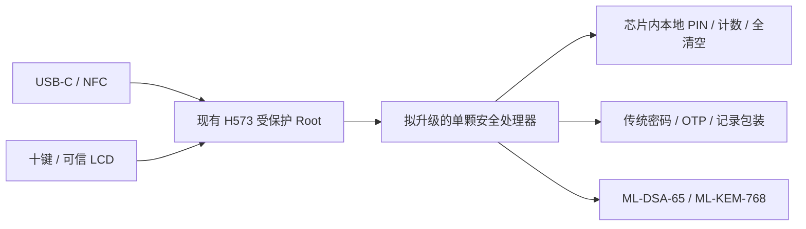

# 后量子研究记录：暂缓实施

[分版](EDITIONS.md) · [经典版优先开发](https://github.com/Jay-Void-BA/OpenKeys/tree/main) · [本分支元数据](../edition.json)

范围：经典版全部安全要求，加芯片内 **ML-DSA-65、ML-KEM-768**；排除 SM2。
优先使用外国芯片，中国芯片备选；无论产地都必须核实大陆交付、个人三颗采购与开发资料。
先完成经典版，本页保存已做的选型研究，不表示开始更换 PCB 或已有后量子固件。

## 尽量保留原架构

继续使用 H573、十键、DFR0555 双行 LCD、USB-C / NFC、Flash 和电源分块。
优先比较将 SE050 升级为一颗具备传统与后量子能力的安全处理器，保持单一 PIN / 尝试
预算 / 擦除权威；确切器件与 API 未确认前，不采用截图中的 U5 + 双 SE 电路。
如果升级器件不能覆盖所需传统算法和原生授权，则该方案尚不合格，不能靠静默减少功能
或在普通 MCU 中运行私钥算法来补齐。

以上是职责框图，**不是已连接的电路或已支持的 API**。现有 R05 U5 仍为 SE050E2。

## 器件优先顺序

| 顺序 | 候选 | 公开依据 | 未解决事项 |
|---|---|---|---|
| 外国优先 1 | ST33K1M5M / A + 对应 NesLib / NesLib-PQML 2.1 | 原厂列出 I²C / SPI 与 PQC 库，特定芯片 / 库有 EUCC 条目 | 确切封装与完整订货号、同一修订的兼容库、65 / 768 配置、可用安全应用、PIN / ACL、Rust 工具链或接口、许可和个人三颗交付 |
| 外国备选 | Infineon TEGRION SLC27 + 对应 PQC 库 | 原厂公布 ML-KEM / ML-DSA 库与样片 / 量产供应声明 | 可用封装 / API、全部传统算法与 PIN 边界、三颗采购及资料权限 |
| 中国备选 | 国芯科技 / 中云信安 CUni360SQ-ZX | 原厂介绍 PQC 升级型号；公开量产报道 | 最终 FIPS 参数集、完整传统算法 / PIN / 权限、可审计 COS、Rust 适配、完整数据手册与三颗供货 |

ST 的安全处理器不是焊上即有 PIN 功能的 SE050 替代料。认证范围不覆盖客户应用；
必须提供或开发芯片内的安全应用，管理密钥、PIN、限次、掉电恢复和授权期限。
“32 位 RISC”不等于 RISC-V；不能因候选中国芯片称 RISC 就宣称已支持 Rust。
供货声明、样片资格与零售库存是不同证据，目前没有锁定任何器件或取得专项报价。

不得把只支持后量子固件更新、或承诺未来升级的普通 TPM，当成现在就能运行目标算法
的硬件。QVault 等候选也需要核对确切工程 / 量产固件与认证状态；未纳入已选 BOM。

## 保持的安全门槛

- 原生 PIN / 私钥权限由安全处理器强制，不能相信 H573 或管理器的解锁布尔值。
- 六位本地 PIN、独立协议 PIN、全局第 11 次错误 / 改 PIN 全清空、原有 30 秒会话规则不变。
- 签名 / 解封装私钥与可重建种子不离开安全处理器；只保存密文后交 MCU 计算不合格。
- 普通主机不能转发任意底层命令、绕过权限、恢复工厂默认授权或重放旧会话。
- 升级器件时重算电压 / 时序 / 峰值功耗、故障互锁和无电池 USB；保持独立 SCA / FI 实测。
- 自研代码保持 Rust / Zig；厂商 ROM / 库属于需记录版本、许可和评估范围的依赖。
- 新增算法不使现有 X25519 管理通道或传统启动签名自动成为后量子方案，不宣称整机全链路抗量子。

## 恢复开发之前

先验收经典版并复核共用修复，再取得可采购 / 可开发的候选资料；冻结接口与器件，
更新原理图 / PCB 后编写对应固件。硬件、软件和每台设备的验证证据分别记录。
本分支继承的 CI 只检查经典版基线；产物明确标为 `pqc-inherited-classical-*`，不是
后量子认证器或新 PCB 的固件。硬件和两算法后端未实现期间保持生产放行 BLOCKED。

## 来源（核对于 2026-11-11）

- [ST33K1M5M 原厂产品与接口 / PQC 库说明](https://www.st.com/en/secure-mcus/st33k1m5m.html)。
- [ST PQML 产品说明](https://www.st.com/content/st_com/en/campaigns/pqc-certified-secure-libraries-z26.html)。
- [ENISA：NesLib-PQML 2.1 与指定 ST33K1M5A / M 的认证范围](https://certification.enisa.europa.eu/certificates/eucc-3090-2026-000067-i-00_en)。
- [Infineon SLC27 原厂说明](https://www.infineon.com/technology-news/2025/INFCSS202510-004)。
- [中云信安产品说明](https://www.chinainfosafe.com/product/product55.html)；同页可能展示旧型号，需取得确切 SQ-ZX 资料，不能借用旧款引脚。
- [CUni360SQ-ZX 量产报道](https://www.stcn.com/article/detail/4196334.html)，不是个人三颗订单承诺。
