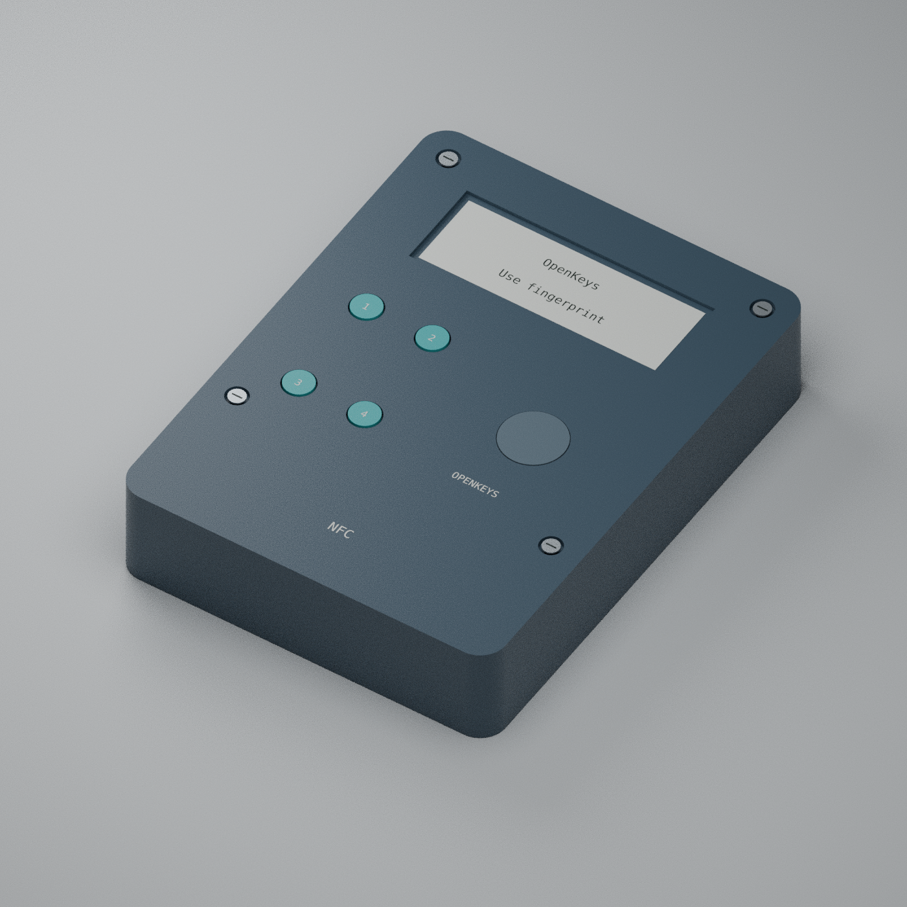

# OpenKeys R0.4 electrical PCB candidate

> **历史 R0.4：指纹＋四键，已被 [R0.5 PIN 十键](../r05/README.md)取代。** 本目录、手册和诊断镜像只用于旧版追溯，不能与 R0.5 混用。

本版遵循“先电路/PCB，后按实板引脚编写固件”。`kicad/OpenKeys.kicad_pcb` 是含实际网络、全部元件、接地过孔及四层布线的电气板。源原理图有10页、BOM有130个位置（包括板载铜天线和DNP调试口）。本目录不混用R0.3的未布线放置研究。

本版是待样板验证的工程候选。电气连通、ERC/DRC和被动网络模拟不等于真实指纹授权、FIDO互通、防降压或侧信道资格。用户计划的3把设备应使用完全相同的板号/固件哈希分别验收，不能把三块未经上电的板直接当成三把合格密钥。



| 文件 | 用途 |
|---|---|
| [原理图PDF](exports/OpenKeys-schematic.pdf)、[KiCad原理图](kicad/OpenKeys.kicad_sch) | 可审查及编辑的实际连接 |
| [电气PCB](kicad/OpenKeys.kicad_pcb)、[项目设置](kicad/OpenKeys.kicad_pro) | 68×92×1mm、四层、顶部USB局部伸出2.5mm |
| [Gerber/钻孔ZIP](exports/OpenKeys-fabrication.zip) | 本候选板的制造几何数据；不是量产许可 |
| [BOM](BOM.csv)、[贴片坐标](exports/OpenKeys-SMD-position.csv)、[引脚表](pinout.csv) | 电气/贴装资料；外接模块及机械件另见下文 |
| [尺寸图](exports/OpenKeys-dimensions.svg)、[尺寸PDF](exports/OpenKeys-dimensions.pdf) | 74×98×20mm外壳、按键、LCD、指纹与电池位置 |
| [OpenSCAD](mechanical/enclosure.scad)、[STL](exports)、[Blender](mechanical/OpenKeys-assembly.blend)、[板体STEP](exports/OpenKeys-PCB.step) | STEP仅为板体/孔，不包含供应商器件3D模型 |
| [最终DRC](review/routed-drc.json)、[独立板网核对](review/board-check.json)、[ERC](review/erc.json) | 最终文件的电气证据 |
| [模拟结果](review/simulation.json)、[输入保护计算](review/protection-calculations.json)、[文件摘要](review/cad-manifest.json) | 明示模型假设，哈希绑定交付文件 |
| [安全测试方法](../../docs/SECURITY_TEST_PLAN.md) | 家用/工厂/实验室分工、负向案例和证据格式 |

## 器件与电源

- STM32H573RIT6 + SE050E2HQ1/Z01Z3Z；FPC2534AM **100026230**认证指纹模块，Hirose FH12-12S-0.5SH(55)底接触插座；不接受只输出“匹配GPIO”的普通指纹模块替代。
- Newhaven **NHD-C0216CiZ-FSW-FBW-3V3**，16×2字符、白背光，当前资料为AiP31032控制器。逻辑供电3.0V、I2C地址7位0x3E；PC3复位必须开漏。
- USB-C母口HRO TYPE-C-31-M-12；只做USB2 FS。两个独立5.1k CC下拉，不请求PD高压。TPS259470L eFuse、PPTC、输入TVS和USB低电容ESD均在原理图内。
- BQ25185输入档100mA、4.2V终止、100mA充电目标；系统共享功率，电池可辅助瞬时负载。Apple20W USB-C适配器用**5V**档：输入预算约**0.50W**，电池侧目标上限约**0.42W**，不等于持续实测充电功率。充电服务当前要求开关ON；这不需要用户解锁秘密。
- **Adafruit1578**受保护500mAh单节包：29×36×4.75mm、约10.5g，设计预留32×38.8×6.5mm且不能压迫软包。电池保护板不是整机安全认证。J2标准2针JST PH2，装前测量极性。
- **Semitec103AT-2**真实10k/B3435热敏，绝缘贴合电芯，独立J6 JST SH2。电池原包不含NTC，必须做独立线束，不能换成固定电阻或只测室内温度。
- 100mA属于约0.2C的温和充电目标，寿命仍取决于温度、SOC和实际电芯，不承诺循环数。不要对电芯额外加热焊接；使用厂家焊接/压接的保护包和线束。

## 板层、天线和结构

F.Cu / In1.Cu(GND) / In2.Cu(GND与少量信号) / B.Cu，1.0mm板厚。最小线宽/间距0.15mm，通孔0.60/0.30mm；In1没有信号走线。层压厂须给出实际介质厚度、材料与阻焊公差，USB差分段需在该叠层下复核；不能仅凭“4层”保证阻抗或EMC。

NFC为FM11NC08S和板载4匝62×15mm铜线圈，RF区域禁止地平面、电池、金属件或一般信号。线圈几何模型约1.20µH，56pF只是首次打样匹配值；最终外壳/电池/手持条件下用VNA调谐并逐台做真实iPhone/Android认证，手机贴靠不会给整机LCD和指纹提供充分电源。必须带电使用。

二维图与PCB本地坐标以左上为零、Y向下；壳体图的PCB平移为(3,3,11)，PCB顶面高度12。STL使用右手坐标 **X=x、Y=98-y、Z从壳背向前**。STEP以KiCad(100,80)为原点，需用实际板面及定位孔核对，不能镜像底层贴片坐标。

外接/手工装配件另购：FPC2534AM模块、500mAh保护电池、103AT-2及压接线束、LCD、49×17.6×0.8mm硬化PC窗、4个M2主紧固件、2个M1.6指纹后托紧固件、绝缘M2触点调节件和软垫。STL包含base/lid/retainer/四个plungers，属于公差待验证的加工源；盖板触点预压、按钮0.30mm目标行程和41mm排线弯折必须用实物装配夹具调整。

硬件提供3.3V独立UV/OV复位、开盖独立复位、复位门控SE使能和LCD清屏复位、关机备用域留痕基础。**SE使能门本身不识别指纹。** 强制指纹必须同时依赖可信启动、正确的TrustZone/GTZC/DMA归属、认证的传感器结果和受保护执行路径。未完成/未验证的固件不能被电路门补足；触点也可能被短接，未声称具备已验证主动防拆网格。

## 重现与冻结

KiCad9.0.2、其`/usr/bin/python3` pcbnew、OpenSCAD2021.01。`tools/export.sh`只校验现存布线并导出，**不会偷偷重建PCB**。`.kicad_pro`中规则与完整源板一起保留。

```sh
sh hardware/r04/tools/export.sh
python3 hardware/r04/tools/manifest.py --check
python3 hardware/r04/tools/simulate.py --ngspice /path/to/ngspice
blender -b -t 2 -P hardware/r04/tools/render.py
```

PDF/PNG尺寸图使用CairoSVG2.8.2从SVG导出。被动网络模拟使用ngspice47；实际开关电源、RF非线性、热、EMC、降压注入及功耗/电磁侧信道未由该模拟覆盖。

仅在**有意修改硬件并准备重新布线**时使用`tools/footprints.py`、`tools/generate.py`、`tools/board.py`、`tools/ground.py`；其中`board.py`不带参数会覆盖现存走线。布线中间DSN采用Freerouting1.9.0，最终交付以KiCad零违规/零未连接及独立网表比对为准，不在CI自动重跑非确定布线器。

必须在板文件和引脚表哈希冻结后修改运行时固件，并让CI核对其板号。更新任一源图/PCB/封装必须重新ERC、DRC、网表/位置比对、导出及生成摘要；修订实物亦须重做受影响的资格测试。
